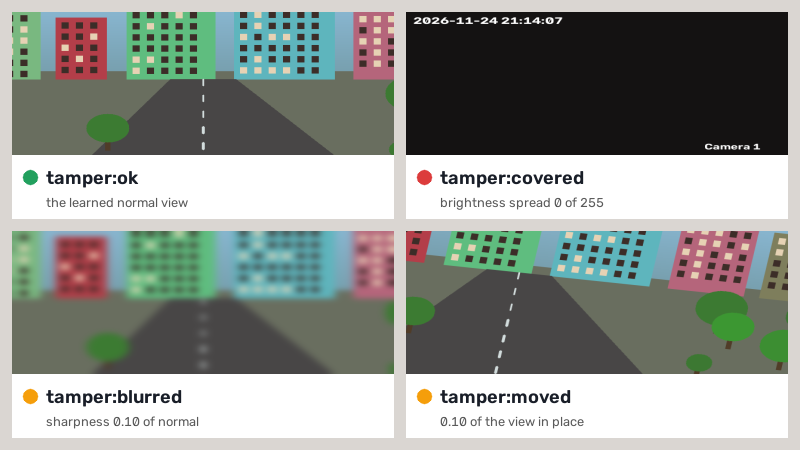

# Tamper Watch

Tamper Watch alerts you when someone covers, blurs or turns one of your cameras, and reports when the view is back to normal.



## What it does

For every camera you assign to it, Tamper Watch takes one frame from the camera's low-resolution stream every 30 seconds and checks three things.

| Result | When |
|---|---|
| `tamper:covered` | The picture is almost one flat tone, or almost black. A hand, tape, a cap, spray paint, a bag over the camera. |
| `tamper:blurred` | The edges in the picture are much softer than this camera's normal. Grease or spray on the lens, or the focus was turned. |
| `tamper:moved` | Most of the camera's normal view is no longer where it was, or the whole view slid sideways or up and down. The camera was turned or knocked. |
| `tamper:ok` | The picture is normal again after one of the above. |

It posts one result when a problem starts and one when it ends, not one every 30 seconds. A problem must be seen on 3 frames in a row before it is posted, and so must its end, so a single odd frame does nothing.

Each result carries the numbers it measured and the limits it compared them with, so you can see why it was posted.

## Alerts

`tamper:covered`, `tamper:blurred` and `tamper:moved` are posted as detections. Turn on the alert for each of these labels on the camera, and they become alerts like Vigiora's own: the Alerts page, notifications, webhooks, camera speakers and the briefing. `tamper:ok` is only a result: the end of a problem never raises an alert. The how-to has the exact steps.

Each alert has a confidence from 0.5 to 0.99: 0.5 when the measurement is just past its limit, close to 0.99 when it is far past it (a black lens, a view that is all gone). The alert has no picture; the camera's recording has the moment.

## How it decides

- **Covered**: the spread of brightness in the picture (from its darkest 5% to its brightest 5%) is very small, or nearly all of it is dark. A date and time burned into the picture does not hide a covered lens.
- **Blurred**: how steep the strongest edges are, compared with the overall contrast. This does not change when the picture gets darker or brighter, or when it gets grainy at night. It is compared with what is normal for this camera.
- **Moved**: Tamper Watch learns where the lasting edges of the view are (buildings, kerbs, door frames), then checks 12 areas of the picture. People and cars hide some areas and leave the others in place. A turned camera loses its edges nearly everywhere, or its whole view fits again a little to one side.

It learns each camera's normal view from its first 10 frames, about 5 minutes. Cameras that switch to black and white night vision get a second normal view, learned the first time they switch. While all is well, the normal view follows slow changes. While a problem is open, it does not learn, so a covered or turned camera is never slowly accepted as normal.

What it learned is kept in the add-on's own storage, so a restart or an update does not start the learning again and does not repeat an alarm that was already posted.

## What it does not do

- **It does not see PTZ cameras correctly.** A camera that pans, tilts or patrols moves on purpose, and Tamper Watch would report it as moved. Turn the moved test off for those cameras (see the how-to). Vigiora Server does not yet tell add-ons which cameras are PTZ, so Tamper Watch only knows if you tag the camera `ptz` or `patrol`, or turn the test off yourself.
- **It does not look at recordings or sound.** It takes one frame every 30 seconds and needs 3 in a row. A camera covered for less than a minute is never reported, and one covered for less than about a minute and a half may not be.
- **It does not report a camera that cannot be reached.** No frame means no verdict. Vigiora's own camera status tells you when a camera is offline.
- **It does not catch small nudges.** A shift of less than about 3% of the picture, or a turn of a few degrees, is not reported. Turns of about 10 degrees or more are usually caught; in a view made mostly of long straight lines (a fence, a roof line), even a larger turn can be missed.

## Limits you should know

- **Weather and dirt.** Heavy rain or snow on the lens, fog, condensation, a spider web or a dirty dome can look like blur, and are reported as blurred. That is often worth knowing, but it is not tampering.
- **A view that really changes.** A truck parked right in front of the camera, a new wall, a large sign: when most of the view is hidden or different for several minutes, it is reported as moved. If the new view is the normal one now, tell Tamper Watch to learn it again (see the how-to).
- **Dark places without night vision.** A camera that films a fully dark place at night, with no infrared light, looks covered. Turn the covered test off for that camera.
- **The first minutes.** During the first 10 frames (about 5 minutes) it only reports covered cameras. The same holds the first time a camera switches to night vision.
- **Tested how.** The tests use drawn street scenes and real video clips from fixed cameras, with brightness changes, grain, a switch to black and white and people walking past. They were not run on a long recording of your own cameras. Start with the default limits and change them if you see false results.

## What it needs

- Vigiora Server 1.7.4 or newer, on a Linux machine with native Docker (community add-ons install only on Linux servers for now).
- 64-bit Linux, on amd64 or arm64. It runs on a Raspberry Pi 4 with a 64-bit system.
- Little memory and CPU: 65 MB in use with 2 cameras, and about 0.3 seconds of CPU per camera every 30 seconds, measured on an arm64 desktop (a Raspberry Pi 4 is a few times slower). No graphics card.

## Permissions

- **See your cameras** (`cameras:read`): to know which cameras you assigned to it, and their tags.
- **Read video streams** (`streams:read`): to take one frame from each assigned camera's low-resolution stream.
- **Add events and results** (`events:write`): to post `tamper:` results.
- **Report alerts** (`alerts:write`): to post covered, blurred and moved as detections, so that the camera's alert rules can turn them into alerts.

It reads frames only from your Vigiora server, never from the cameras directly, and sends nothing anywhere else.

## Licence

Proprietary. See `LICENSE`. Tamper Watch may be used on a Vigiora Server whose account bought it in the Vigiora Community.

## For developers

The detection is in `src/tamper_watch/detect.py` (pure functions on images) and `src/tamper_watch/watch.py` (learning and the per-camera state). The tests draw their own pictures (`tests/scenes.py`).

```sh
python3 -m venv .venv && . .venv/bin/activate
pip install -e ../vigiora-addon-kit        # the Vigiora Add-on Kit, from a checkout
pip install -e '.[dev]'
pytest
python tools/false_alarm_check.py          # scores against the limits; add video files of a fixed camera to check them too
vigiora-addon validate .
```
