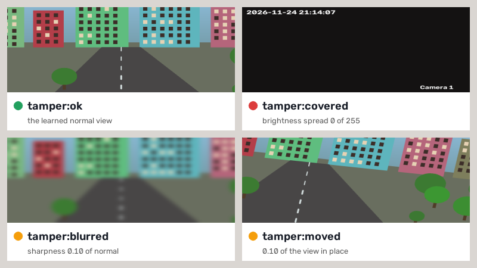

# Tamper Watch: how to set it up and use it

## What it does

Tamper Watch checks each camera you assign to it once every 30 seconds. It posts a result when a camera becomes covered, blurred or moved, and another when the view is normal again:

- `tamper:covered`: the picture is flat or dark (a hand, tape, a cap, paint).
- `tamper:blurred`: the picture is much softer than this camera's normal (grease or spray on the lens, focus turned).
- `tamper:moved`: the camera no longer shows its normal view (turned, knocked, pointed elsewhere).
- `tamper:ok`: the problem has ended. The result says which problem it was and how long it lasted.

A problem, and its end, must be seen on 3 checks in a row (about a minute and a half) before anything is posted.

## Set it up

1. Install Tamper Watch from the Add-ons page of your Vigiora server.
2. Open the Add-ons page and find `tamper-watch`. It shows up once it has enrolled.
3. Assign the cameras you want it to watch.
4. Leave the cameras as they are for about 5 minutes. Tamper Watch learns each camera's normal view from its first 10 checks. During that time it only reports covered cameras.

The first time a camera switches to black and white night vision, Tamper Watch learns its night view the same way. That night, for about 5 minutes, it again only reports covered.

## Where the results show

Each result is listed in the camera's events, with its label and the numbers that led to it.

**Alerts: not yet.** Vigiora Server 1.7 raises alerts (the Alerts page, push notifications, email, chat and alert speakers) only for detections. Community add-ons cannot post detections there, so Tamper Watch's results are events, not alerts. The camera's label list does show `tamper:covered`, `tamper:blurred`, `tamper:moved` and `tamper:ok` once each has been posted, with an alert switch, but in Server 1.7 that switch does nothing for add-on results. Do not rely on it. Tamper Watch will post alerts as soon as the server allows add-ons to.

Each result carries the numbers that led to it, for example:

| Number | Meaning | Problem when |
|---|---|---|
| `brightness_spread` | Brightness range of the picture, 0 to 255 | at most 20 (covered) |
| `brightness_p95` | How bright the brightest part is, 0 to 255 | at most 16 (covered) |
| `sharpness_ratio` | Sharpness now, divided by this camera's normal | below 0.6 (blurred) |
| `areas_in_place` | Share of the picture's areas still where they were | below 0.4 (moved) |
| `shift_percent` | How far the whole view seems to have slid, in percent of the picture | 2.5 or more, with a clear fit (moved) |

## PTZ and patrol cameras

A PTZ camera moves on purpose. Tamper Watch cannot tell a planned move from a turned camera, so turn the moved test off for it. Covered and blurred still work.

- **One camera**: give the camera the tag `ptz` or `patrol` in Vigiora, or set the camera's own setting `moved` to `off` for this add-on.
- **All cameras**: set `TAMPER_MOVED` to `off` (see Settings).

A camera's own setting wins: `moved: on` turns the test back on for a tagged camera that never actually moves.

## When the view changes on purpose

If you move a camera on purpose, or its view changes for good (a new wall, a new sign), Tamper Watch reports it as moved until it learns the new view. To make it learn again, set the camera's setting `relearn` to any new text, for example today's date. If a problem was open, Tamper Watch closes it with `tamper:ok` and the reason, then learns the view again from the next 10 checks.

## Settings

The defaults are written in the add-on's `compose.yaml`. A service-wide setting of the same name on your server wins over them (the lower-case names, such as `blur_ratio`, work too). The camera settings at the end are set per camera.

| Setting | Default | Meaning |
|---|---|---|
| `TAMPER_INTERVAL_SEC` | 30 | Seconds between two checks of a camera. Environment only. |
| `TAMPER_CONFIRM_SAMPLES` | 3 | Checks in a row needed before a problem, or its end, is posted. |
| `TAMPER_LEARN_SAMPLES` | 10 | Checks used to learn a camera's normal view. |
| `TAMPER_ADAPT_RATE` | 0.02 | How fast the learned view follows slow changes while all is well. 0 keeps it fixed. |
| `TAMPER_COVERED` | on | Report covered or dark cameras. |
| `TAMPER_BLURRED` | on | Report blurred cameras. |
| `TAMPER_MOVED` | on | Report moved cameras. |
| `TAMPER_FLAT_SPREAD` | 20 | Covered when the brightness range is at most this (0 to 255). |
| `TAMPER_DARK_LEVEL` | 16 | Covered when 95% of the picture is at most this bright (0 to 255). |
| `TAMPER_BLUR_RATIO` | 0.6 | Blurred when sharpness falls below this share of normal. Lower it to report only stronger blur. |
| `TAMPER_MOVED_MATCH` | 0.4 | Moved when less than this share of the view is still in place. Lower it to report only bigger moves. |
| `TAMPER_GRAB_TIMEOUT_SEC` | 10 | Give up on a camera's stream after this many seconds. |
| `TAMPER_WORKERS` | 2 | Cameras read at the same time. |
| `covered` (camera) | on | Turn the covered test off for this camera. |
| `blurred` (camera) | on | Turn the blurred test off for this camera. |
| `moved` (camera) | auto | `auto` is off for a camera tagged `ptz` or `patrol`, on for the others. `on` or `off` decides it. |
| `relearn` (camera) | empty | Any new text makes it learn this camera's view again. |

## Tune it

- **Too many `tamper:blurred` in rain or fog**: lower `TAMPER_BLUR_RATIO`, for example to 0.45. Or turn `blurred` off for that camera.
- **`tamper:moved` when a truck parks in front of the camera**: raise `TAMPER_CONFIRM_SAMPLES` (6 is about 3 minutes), or lower `TAMPER_MOVED_MATCH` to 0.3.
- **`tamper:covered` every night on a camera without night vision**: turn `covered` off for that camera.
- **A small nudge was not reported**: shifts under about 3% of the picture are ignored on purpose (wind, vibration). Raise `TAMPER_MOVED_MATCH` to 0.5 to report smaller turns, at the cost of more false results when people stand close to the camera.

## Stop it

Use Stop on the add-on on the Add-ons page. It stays enrolled and keeps checking in, but takes no frames and posts nothing until you press Start. What it learned is kept.

## Permissions

It asks for `cameras:read` (which cameras are assigned, and their tags), `streams:read` (one frame of each assigned camera's low-resolution stream every 30 seconds) and `events:write` (the `tamper:` results). It reads frames from your Vigiora server only.

## Troubleshooting

- **It does not appear on the Add-ons page.** Check the container's logs. "cannot enrol yet" means it cannot reach the server; "enrolment refused" means the key is wrong.
- **A camera gets no results at all.** The log says "no picture" when Tamper Watch cannot read the camera's stream. An unreachable camera is never reported as covered. Check that the camera works in Vigiora.
- **Nothing is posted for the first minutes.** It is learning (10 checks). The container's log says "learned its colour view" (or "grey view" for night vision) for each camera when it is done.
- **The camera's resolution changed.** Tamper Watch learns the view again by itself, and closes any open problem with `tamper:ok`.
